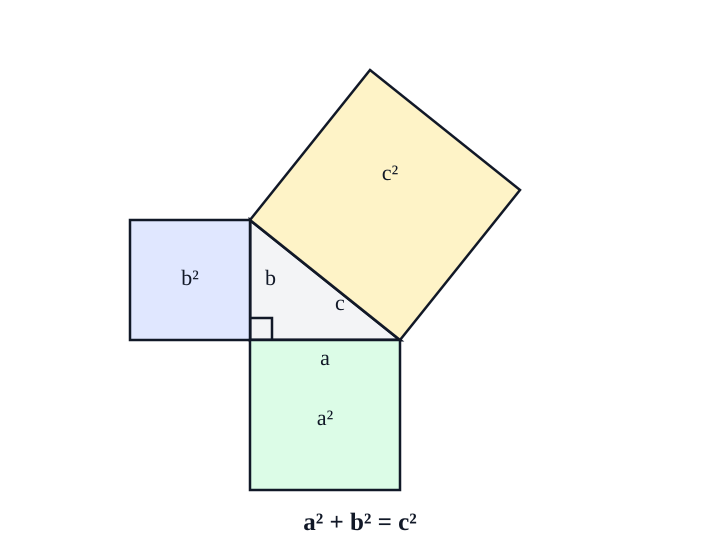

# 3.3 Pytagoras' læresetning

Pytagoras' læresetning beskriver sammenhengen mellom sidene i en rettvinklet trekant.

Siden som ligger mot den rette vinkelen, kalles **hypotenusen**. De to andre sidene kalles **kateter**. Hypotenusen er alltid den lengste siden i en rettvinklet trekant.

!!! important "Pytagoras' læresetning"

    I en rettvinklet trekant er summen av kvadratene av katetene lik kvadratet av hypotenusen.

    $$
    a^2+b^2=c^2
    $$

    Her er $a$ og $b$ katetene, mens $c$ er hypotenusen.

### Hvorfor virker læresetningen?

Når vi tegner et kvadrat på hver side i en rettvinklet trekant, får vi tre kvadrater. Arealet av kvadratet på hypotenusen er like stort som summen av arealene av kvadratene på katetene.

*Kvadratene er konstruert på sidene i trekanten. Arealet av kvadratet på hypotenusen er summen av arealene av kvadratene på katetene.*

!!! example "Eksempel 3.3.1 – Finn hypotenusen"

    En rettvinklet trekant har kateter på 6 cm og 8 cm. Finn hypotenusen.

    Vi setter inn katetene i Pytagoras' læresetning:

    $$
    \begin{aligned}
    6^2+8^2&=c^2\\
    36+64&=c^2\\
    100&=c^2\\
    c&=\sqrt{100}=10
    \end{aligned}
    $$

    $$
    \underline{\underline{c=10\text{ cm}}}
    $$

!!! example "Eksempel 3.3.2 – Finn en katet"

    En rettvinklet trekant har hypotenus 13 cm og én katet 5 cm. Finn den andre kateten.

    Vi setter inn de kjente sidene:

    $$
    \begin{aligned}
    5^2+b^2&=13^2\\
    25+b^2&=169\\
    b^2&=169-25=144\\
    b&=\sqrt{144}=12
    \end{aligned}
    $$

    Vi bruker den positive kvadratroten fordi en sidelengde må være positiv.

    $$
    \underline{\underline{b=12\text{ cm}}}
    $$

### Den omvendte Pytagoras-setningen

Hvis vi kjenner alle tre sidelengdene i en trekant, kan vi undersøke om trekanten er rettvinklet. Vi må først identifisere den lengste siden.

!!! important "Den omvendte Pytagoras-setningen"

    Hvis $c$ er den lengste siden i en trekant, og

    $$
    a^2+b^2=c^2,
    $$

    er trekanten rettvinklet.

!!! example "Eksempel 3.3.3 – Er trekanten rettvinklet?"

    En trekant har sidene 5 cm, 12 cm og 13 cm. Undersøk om trekanten er rettvinklet.

    Den lengste siden er 13 cm. Vi undersøker om kvadratet av denne siden er lik summen av kvadratene av de to andre:

    $$
    \begin{aligned}
    5^2+12^2&=25+144\\
    &=169\\
    13^2&=169
    \end{aligned}
    $$

    Likheten stemmer. Trekanten er rettvinklet.

    $$
    \underline{\underline{\text{Ja, trekanten er rettvinklet.}}}
    $$

### Vanlige feil

- Å bruke Pytagoras i en trekant som ikke er rettvinklet.
- Å bruke en katet som hypotenus.
- Å glemme kvadratroten når vi finner en sidelengde.
- Å glemme at den lengste siden må være hypotenusen når vi bruker den omvendte setningen.

## Oppgaver

!!! question "Oppgave 3.3.1 – Finn hypotenusen"

    En rettvinklet trekant har kateter på 9 cm og 12 cm. Finn hypotenusen.

??? note "Fasit – oppgave 3.3.1"

    $$
    \begin{aligned}
    c^2&=9^2+12^2\\
    &=81+144=225\\
    c&=\sqrt{225}=15
    \end{aligned}
    $$

    $$
    \underline{\underline{c=15\text{ cm}}}
    $$

!!! question "Oppgave 3.3.2 – Finn den ukjente kateten"

    Hypotenusen i en rettvinklet trekant er 10 cm. Den ene kateten er 6 cm. Finn den andre kateten.

??? note "Fasit – oppgave 3.3.2"

    $$
    \begin{aligned}
    6^2+b^2&=10^2\\
    b^2&=100-36=64\\
    b&=\sqrt{64}=8
    \end{aligned}
    $$

    $$
    \underline{\underline{b=8\text{ cm}}}
    $$

!!! question "Oppgave 3.3.3 – Kontroller en trekant"

    En trekant har sidene 7 cm, 24 cm og 25 cm. Er trekanten rettvinklet? Vis hvordan du undersøker det.

??? note "Fasit – oppgave 3.3.3"

    Den lengste siden er 25 cm.

    $$
    7^2+24^2=49+576=625=25^2
    $$

    $$
    \underline{\underline{\text{Trekanten er rettvinklet.}}}
    $$

!!! question "Oppgave 3.3.4 – Pytagoras i en praktisk situasjon"

    En stige står 3 m fra en loddrett vegg. Den når 4 m opp på veggen. Hvor lang er stigen? Anta at veggen og bakken står vinkelrett på hverandre.

??? note "Fasit – oppgave 3.3.4"

    Stigen er hypotenusen i en rettvinklet trekant:

    $$
    \begin{aligned}
    c^2&=3^2+4^2\\
    &=9+16=25\\
    c&=\sqrt{25}=5
    \end{aligned}
    $$

    $$
    \underline{\underline{\text{Stigen er 5 m lang.}}}
    $$

---
