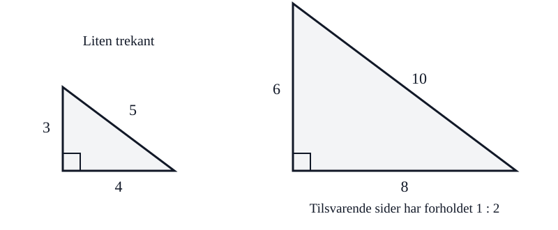

# 3.5 Formlikhet i praktiske situasjoner

To figurer er formlike når de har samme form, men ikke nødvendigvis samme størrelse. Tilsvarende vinkler er like store, og forholdet mellom tilsvarende sider er konstant.

!!! important "Formlikhet"

    To trekanter er formlike når de har parvis like store vinkler. Da er forholdet mellom tilsvarende sider det samme.

    Hvis tilsvarende sider i to trekanter er $a_1$ og $a_2$, $b_1$ og $b_2$, og $c_1$ og $c_2$, gjelder

    $$
    \frac{a_1}{a_2}=\frac{b_1}{b_2}=\frac{c_1}{c_2}.
    $$

*De tilsvarende vinklene er like store, og forholdet mellom tilsvarende sider er det samme.*

!!! example "Eksempel 3.5.1 – Finn en ukjent side"

    To trekanter er formlike. En side på 3 cm i den lille trekanten svarer til 6 cm i den store. En annen side i den lille trekanten er 4 cm. Hvor lang er den tilsvarende siden i den store trekanten?

    Først finner vi målestokkfaktoren:

    $$
    k=\frac{6}{3}=2
    $$

    Vi ganger den tilsvarende siden med 2:

    $$
    4\cdot2=8
    $$

    $$
    \underline{\underline{8\text{ cm}}}
    $$

!!! example "Eksempel 3.5.2 – Finn høyden på et tre"

    Et tre kaster en skygge på 6 m. Samtidig kaster en loddrett pinne på 1,5 m en skygge på 2 m. Finn høyden på treet. Vi antar at bakken er plan, og at solstrålene kan regnes som parallelle.

    Trekantene som dannes av høydene og skyggene, er formlike. Forholdet mellom høyde og skygge er derfor likt:

    $$
    \begin{aligned}
    \frac{h}{6}&=\frac{1{,}5}{2}\\
    h&=\frac{6\cdot1{,}5}{2}\\
    h&=4{,}5
    \end{aligned}
    $$

    $$
    \underline{\underline{h=4{,}5\text{ m}}}
    $$

### Når bruker vi formlikhet, og når bruker vi Pytagoras?

- Bruk **formlikhet** når figurer har samme form, og du kjenner forholdet mellom tilsvarende sider.
- Bruk **Pytagoras** når du har en rettvinklet trekant og kjenner to av sidene.

Noen problemer kan løses med begge metodene. Da må du undersøke hvilke opplysninger du har, og begrunne metodevalget.

## Oppgaver

!!! question "Oppgave 3.5.1 – Målestokk"

    På et kart er avstanden mellom to steder 3 cm. Kartet har målestokk 1:50 000. Hvor langt er det i virkeligheten? Svar i kilometer.

??? note "Fasit – oppgave 3.5.1"

    1 cm på kartet svarer til 50 000 cm i virkeligheten.

    $$
    \begin{aligned}
    3\cdot50\,000&=150\,000\text{ cm}\\
    &=1\,500\text{ m}=1{,}5\text{ km}
    \end{aligned}
    $$

    $$
    \underline{\underline{1{,}5\text{ km}}}
    $$

!!! question "Oppgave 3.5.2 – Modeller"

    En modell er formlik med en bygning. Modellen er 40 cm høy, mens bygningen er 20 m høy.

    a) Hvor mange centimeter høy er bygningen?

    b) Hvor mange ganger større er bygningen enn modellen?

??? note "Fasit – oppgave 3.5.2"

    a) $20\text{ m}=2\,000\text{ cm}$.

    b)

    $$
    2\,000:40=50
    $$

    $$
    \underline{\underline{\text{Bygningen er 50 ganger så høy.}}}
    $$

!!! question "Oppgave 3.5.3 – Velg metode"

    Du skal finne høyden på en flaggstang. Du kan måle skyggen til flaggstangen og skyggen til en meterstokk samtidig.

    a) Hvilken metode vil du bruke?

    b) Forklar hvorfor metoden passer.

    c) Hvilke forutsetninger må være oppfylt?

??? note "Fasit – oppgave 3.5.3"

    a) $\underline{\underline{\text{Formlikhet}}}$.

    b) Skyggen og høyden danner rettvinklede trekanter med samme vinkel fra solstrålene. Trekantene er derfor formlike.

    c) Vi må blant annet anta at bakken er plan, at gjenstandene står loddrett, og at solstrålene kan regnes som parallelle.

---
