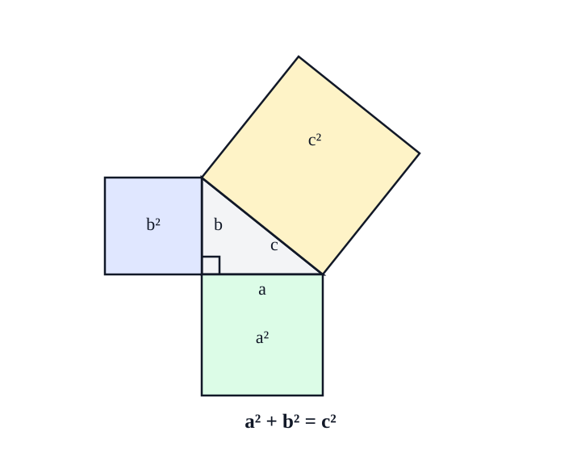
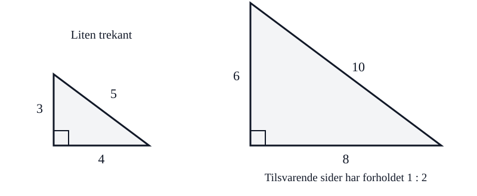

# Kapittel 3: Trekanter, Pytagoras og geometriske undersøkelser

> **Forkunnskaper:** Trekantbegreper, vinkler, forhold, kvadrering, kvadratrøtter og enkel algebra. Nødvendige forkunnskaper repeteres underveis.

## Dette skal du lære

Etter kapitlet skal du kunne:

- beskrive og klassifisere trekanter ved hjelp av sider og vinkler
- undersøke og begrunne sammenhenger mellom sidelengder
- bruke Pytagoras i rettvinklede trekanter
- bruke formlikhet og Pytagoras i praktiske situasjoner
- velge og begrunne hvilken metode som passer
- undersøke hvordan geometriske løsninger endres når forutsetningene endres
- argumentere for egne løsninger og vurdere om svarene er rimelige

## Før du begynner

Prøv oppgavene. Hvis noe er vanskelig, bruk repetisjonen underveis i kapitlet.

!!! question "Oppgave 3.0.1 – Forkunnskaper"

    a) Hvor mange grader er vinkelsummen i en trekant?

    b) Regn ut $6^2$ og $\sqrt{49}$.

    c) En tegning er 4 cm lang, mens den virkelige lengden er 8 m. Hvor mange meter svarer 1 cm på tegningen til?

    d) Skriv et uttrykk for «tre ganger et tall pluss 2».

??? note "Fasit – oppgave 3.0.1"

    a) $\underline{\underline{180^\circ}}$.

    b) $\underline{\underline{6^2=36}}$ og $\underline{\underline{\sqrt{49}=7}}$.

    c) $8:4=2$. $\underline{\underline{2\text{ m}}}$ per centimeter på tegningen.

    d) Hvis tallet er $x$, blir $\underline{\underline{3x+2}}$.

---

## 3.1 Hva vet vi om trekanter?

En trekant har tre sider og tre vinkler. Vi kan klassifisere trekanter etter sidelengdene eller etter vinklene. En trekant kan tilhøre én kategori fra hver av disse inndelingene.

### Trekanttyper

- **Likesidet trekant:** Alle tre sidene er like lange. Alle vinklene er $60^\circ$.
- **Likebeint trekant:** To sider er like lange. Vinklene ved grunnlinjen er like store.
- **Uliksidet trekant:** Alle sidene har forskjellig lengde.
- **Spissvinklet trekant:** Alle vinklene er mindre enn $90^\circ$.
- **Rettvinklet trekant:** Én vinkel er $90^\circ$.
- **Stumpvinklet trekant:** Én vinkel er større enn $90^\circ$.

### Vinkelsummen i en trekant

!!! important "Vinkelsummen i en trekant"

    Summen av de tre vinklene i en trekant er alltid $180^\circ$.

    $$
    A+B+C=180^\circ
    $$

!!! example "Eksempel 3.1.1 – Finn den siste vinkelen"

    To vinkler i en trekant er $48^\circ$ og $67^\circ$. Hvor stor er den tredje vinkelen?

    Vi trekker de to kjente vinklene fra $180^\circ$:

    $$
    \begin{aligned}
    C&=180^\circ-48^\circ-67^\circ\\
    &=65^\circ
    \end{aligned}
    $$

    $$
    \underline{\underline{C=65^\circ}}
    $$

### Hvorfor er grunnvinklene i en likebeint trekant like?

Tenk deg en likebeint trekant der de to sidene fra toppen er like lange. Vi tegner vinkelhalveringslinjen fra toppen ned til grunnlinjen. Da deler vi toppvinkelen i to like store vinkler.

De to trekantene som oppstår, har:

- én side hver som er like lang, fordi trekanten er likebeint
- samme vinkel ved toppen, fordi vi har halvert vinkelen
- den tegnede linjen som felles side

Trekantene er derfor kongruente etter side–vinkel–side. Da er også vinklene ved grunnlinjen like store.

### Utforsk likebeinte trekanter

Tegn to likebeinte trekanter med ulik toppvinkel. Mål grunnvinklene i begge trekantene.

- Hva observerer du?
- Stemmer målingene med påstanden ovenfor?
- Hvorfor er et kongruensargument sterkere enn bare å måle?

## Oppgaver

!!! question "Oppgave 3.1.1 – Klassifiser trekanter"

    En likebeint trekant har toppvinkel $80^\circ$.

    a) Hvor store er grunnvinklene?

    b) Hva slags trekant er dette klassifisert etter vinklene?

??? note "Fasit – oppgave 3.1.1"

    a) Grunnvinklene er like store. Vinkelsummen er $180^\circ$, så hver grunnvinkel er

    $$
    \frac{180^\circ-80^\circ}{2}=50^\circ.
    $$

    $$
    \underline{\underline{50^\circ}}
    $$

    b) Alle vinklene er mindre enn $90^\circ$, så $\underline{\underline{\text{trekanten er spissvinklet}}}$.

!!! question "Oppgave 3.1.2 – Vinkelsum"

    En trekant har én vinkel på $38^\circ$ og én vinkel på $92^\circ$.

    a) Finn den tredje vinkelen.

    b) Hva slags trekant er dette klassifisert etter vinklene?

??? note "Fasit – oppgave 3.1.2"

    a)

    $$
    180^\circ-38^\circ-92^\circ=50^\circ
    $$

    $$
    \underline{\underline{50^\circ}}
    $$

    b) Trekanten er stumpvinklet fordi én vinkel er større enn $90^\circ$.

!!! question "Oppgave 3.1.3 – Begrunn en egenskap"

    En elev måler en likebeint trekant og finner at grunnvinklene er omtrent $54^\circ$.

    Forklar hvorfor grunnvinklene må være like store også i en likebeint trekant som eleven ikke har målt.

??? note "Fasit – oppgave 3.1.3"

    Tegn vinkelhalveringslinjen fra toppvinkelen. De to trekantene som dannes, er kongruente etter side–vinkel–side: De har to like lange sider og samme vinkel mellom sidene. Tilsvarende vinkler i kongruente trekanter er like. Derfor er $\underline{\underline{\text{grunnvinklene like store}}}$.

---

## 3.2 Sammenhenger mellom sidelengdene

Det er ikke mulig å velge tre vilkårlige lengder og alltid få en trekant. Sidelengdene må passe sammen.

!!! important "Trekantulikheten"

    Summen av lengdene til to sider i en trekant må være større enn lengden til den tredje siden.

    For sidene $a$, $b$ og $c$ må alle tre ulikhetene gjelde:

    $$
    a+b>c,\qquad a+c>b,\qquad b+c>a
    $$

!!! example "Eksempel 3.2.1 – Kan lengdene danne en trekant?"

    Kan vi lage en trekant med sidene 3 cm, 4 cm og 8 cm?

    Vi undersøker om summen av de to korteste sidene er større enn den lengste:

    $$
    3+4=7
    $$

    Siden $7$ ikke er større enn $8$, kan lengdene ikke danne en trekant.

    $$
    \underline{\underline{\text{Nei, det er ikke mulig.}}}
    $$

## Oppgaver

!!! question "Oppgave 3.2.1 – Undersøk sidelengder"

    Undersøk om sidelengdene kan danne en trekant.

    a) 4 cm, 5 cm og 7 cm

    b) 3 cm, 6 cm og 10 cm

    c) 6 cm, 6 cm og 12 cm

??? note "Fasit – oppgave 3.2.1"

    a) $\underline{\underline{\text{Ja}}}$. Alle tre ulikhetene er oppfylt.

    b) $\underline{\underline{\text{Nei}}}$. $3+6=9<10$.

    c) $\underline{\underline{\text{Nei}}}$. $6+6=12$, men summen må være større enn 12.

!!! question "Oppgave 3.2.2 – Finn mulige lengder"

    To sider i en trekant er 5 cm og 9 cm. Sidelengden til den tredje siden er et helt antall centimeter.

    Hvilke lengder kan den tredje siden ha? Begrunn svaret.

??? note "Fasit – oppgave 3.2.2"

    Kall den siste siden $x$. Trekantulikheten gir:

    $$
    5+x>9\quad\Rightarrow\quad x>4
    $$

    og

    $$
    5+9>x\quad\Rightarrow\quad x<14.
    $$

    Den tredje siden må være større enn 4 cm og mindre enn 14 cm. Mulige heltallige lengder er

    $$
    \underline{\underline{5,6,7,8,9,10,11,12,13\text{ cm}}}
    $$

---

## 3.3 Pytagoras' læresetning

Pytagoras' læresetning beskriver sammenhengen mellom sidene i en rettvinklet trekant.

Siden som ligger mot den rette vinkelen, kalles **hypotenusen**. De to andre sidene kalles **kateter**. Hypotenusen er alltid den lengste siden i en rettvinklet trekant.

!!! important "Pytagoras' læresetning"

    I en rettvinklet trekant er summen av kvadratene av katetene lik kvadratet av hypotenusen.

    $$
    a^2+b^2=c^2
    $$

    Her er $a$ og $b$ katetene, mens $c$ er hypotenusen.

### Hvorfor virker læresetningen?

Når vi tegner et kvadrat på hver side i en rettvinklet trekant, får vi tre kvadrater. Arealet av kvadratet på hypotenusen er like stort som summen av arealene av kvadratene på katetene.

*Kvadratene er konstruert på sidene i trekanten. Arealet av kvadratet på hypotenusen er summen av arealene av kvadratene på katetene.*

!!! example "Eksempel 3.3.1 – Finn hypotenusen"

    En rettvinklet trekant har kateter på 6 cm og 8 cm. Finn hypotenusen.

    Vi setter inn katetene i Pytagoras' læresetning:

    $$
    \begin{aligned}
    6^2+8^2&=c^2\\
    36+64&=c^2\\
    100&=c^2\\
    c&=\sqrt{100}=10
    \end{aligned}
    $$

    $$
    \underline{\underline{c=10\text{ cm}}}
    $$

!!! example "Eksempel 3.3.2 – Finn en katet"

    En rettvinklet trekant har hypotenus 13 cm og én katet 5 cm. Finn den andre kateten.

    Vi setter inn de kjente sidene:

    $$
    \begin{aligned}
    5^2+b^2&=13^2\\
    25+b^2&=169\\
    b^2&=169-25=144\\
    b&=\sqrt{144}=12
    \end{aligned}
    $$

    Vi bruker den positive kvadratroten fordi en sidelengde må være positiv.

    $$
    \underline{\underline{b=12\text{ cm}}}
    $$

### Den omvendte Pytagoras-setningen

Hvis vi kjenner alle tre sidelengdene i en trekant, kan vi undersøke om trekanten er rettvinklet. Vi må først identifisere den lengste siden.

!!! important "Den omvendte Pytagoras-setningen"

    Hvis $c$ er den lengste siden i en trekant, og

    $$
    a^2+b^2=c^2,
    $$

    er trekanten rettvinklet.

!!! example "Eksempel 3.3.3 – Er trekanten rettvinklet?"

    En trekant har sidene 5 cm, 12 cm og 13 cm. Undersøk om trekanten er rettvinklet.

    Den lengste siden er 13 cm. Vi undersøker om kvadratet av denne siden er lik summen av kvadratene av de to andre:

    $$
    \begin{aligned}
    5^2+12^2&=25+144\\
    &=169\\
    13^2&=169
    \end{aligned}
    $$

    Likheten stemmer. Trekanten er rettvinklet.

    $$
    \underline{\underline{\text{Ja, trekanten er rettvinklet.}}}
    $$

### Vanlige feil

- Å bruke Pytagoras i en trekant som ikke er rettvinklet.
- Å bruke en katet som hypotenus.
- Å glemme kvadratroten når vi finner en sidelengde.
- Å glemme at den lengste siden må være hypotenusen når vi bruker den omvendte setningen.

## Oppgaver

!!! question "Oppgave 3.3.1 – Finn hypotenusen"

    En rettvinklet trekant har kateter på 9 cm og 12 cm. Finn hypotenusen.

??? note "Fasit – oppgave 3.3.1"

    $$
    \begin{aligned}
    c^2&=9^2+12^2\\
    &=81+144=225\\
    c&=\sqrt{225}=15
    \end{aligned}
    $$

    $$
    \underline{\underline{c=15\text{ cm}}}
    $$

!!! question "Oppgave 3.3.2 – Finn den ukjente kateten"

    Hypotenusen i en rettvinklet trekant er 10 cm. Den ene kateten er 6 cm. Finn den andre kateten.

??? note "Fasit – oppgave 3.3.2"

    $$
    \begin{aligned}
    6^2+b^2&=10^2\\
    b^2&=100-36=64\\
    b&=\sqrt{64}=8
    \end{aligned}
    $$

    $$
    \underline{\underline{b=8\text{ cm}}}
    $$

!!! question "Oppgave 3.3.3 – Kontroller en trekant"

    En trekant har sidene 7 cm, 24 cm og 25 cm. Er trekanten rettvinklet? Vis hvordan du undersøker det.

??? note "Fasit – oppgave 3.3.3"

    Den lengste siden er 25 cm.

    $$
    7^2+24^2=49+576=625=25^2
    $$

    $$
    \underline{\underline{\text{Trekanten er rettvinklet.}}}
    $$

!!! question "Oppgave 3.3.4 – Pytagoras i en praktisk situasjon"

    En stige står 3 m fra en loddrett vegg. Den når 4 m opp på veggen. Hvor lang er stigen? Anta at veggen og bakken står vinkelrett på hverandre.

??? note "Fasit – oppgave 3.3.4"

    Stigen er hypotenusen i en rettvinklet trekant:

    $$
    \begin{aligned}
    c^2&=3^2+4^2\\
    &=9+16=25\\
    c&=\sqrt{25}=5
    \end{aligned}
    $$

    $$
    \underline{\underline{\text{Stigen er 5 m lang.}}}
    $$

---

## 3.4 Spesielle trekantforhold: 30°–60°–90°

En likesidet trekant har tre sider som er like lange, og tre vinkler på $60^\circ$. Hvis vi tegner vinkelhalveringslinjen fra ett hjørne, deler den trekanten i to kongruente rettvinklede trekanter.

Fordi de to deltrekantene er kongruente, deler linjen grunnlinjen i to like lange deler. Vinkelen på $60^\circ$ blir delt i to vinkler på $30^\circ$. Den siste vinkelen i hver deltrekant er derfor $90^\circ$.

Vi bruker Pytagoras for å finne forholdet mellom sidene.

!!! important "Sideforhold i en 30°–60°–90°-trekant"

    Hvis den korteste kateten er $a$, er sidene:

    $$
    a,\quad a\sqrt{3},\quad 2a
    $$

    Forholdet mellom sidene er

    $$
    1:\sqrt{3}:2
    $$

!!! example "Eksempel 3.4.1 – Finn katetene"

    En rettvinklet trekant har vinklene $30^\circ$, $60^\circ$ og $90^\circ$. Hypotenusen er 10 cm. Finn katetene.

    Sideforholdet er $1:\sqrt{3}:2$. Hypotenusen svarer til 2 deler. Én del er derfor

    $$
    10:2=5
    $$

    Katetene er 5 cm og $5\sqrt{3}$ cm.

    $$
    \underline{\underline{5\text{ cm og }5\sqrt{3}\text{ cm}}}
    $$

    Den lengste kateten er omtrent 8,66 cm.

**Viktig:** Sideforholdet gjelder bare når vinklene er $30^\circ$, $60^\circ$ og $90^\circ$. Det gjelder ikke for alle rettvinklede trekanter.

## Oppgaver

!!! question "Oppgave 3.4.1 – Bruk sideforholdet"

    En 30°–60°–90°-trekant har korteste katet 4 cm. Finn hypotenusen og den lengste kateten.

??? note "Fasit – oppgave 3.4.1"

    Sideforholdet er $1:\sqrt{3}:2$.

    $$
    \begin{aligned}
    \text{Hypotenusen}&=2\cdot4=8\\
    \text{Lengste katet}&=4\sqrt{3}
    \end{aligned}
    $$

    $$
    \underline{\underline{8\text{ cm og }4\sqrt{3}\text{ cm}}}
    $$

!!! question "Oppgave 3.4.2 – Begrunn sideforholdet"

    Forklar hvordan vi kan bruke en likesidet trekant og Pytagoras til å finne sideforholdet i en 30°–60°–90°-trekant.

??? note "Fasit – oppgave 3.4.2"

    Vi deler en likesidet trekant med sidelengde $2a$ ved hjelp av vinkelhalveringslinjen fra et hjørne. De to deltrekantene er kongruente, så grunnlinjen deles i to like deler. Hver deltrekant får vinklene $30^\circ$, $60^\circ$ og $90^\circ$. Den korteste kateten er $a$, og hypotenusen er $2a$.

    Med Pytagoras blir den lengste kateten $h$:

    $$
    \begin{aligned}
    a^2+h^2&=(2a)^2\\
    h^2&=4a^2-a^2=3a^2\\
    h&=a\sqrt{3}
    \end{aligned}
    $$

    Forholdet blir dermed

    $$
    \underline{\underline{1:\sqrt{3}:2}}
    $$

---

## 3.5 Formlikhet i praktiske situasjoner

To figurer er formlike når de har samme form, men ikke nødvendigvis samme størrelse. Tilsvarende vinkler er like store, og forholdet mellom tilsvarende sider er konstant.

!!! important "Formlikhet"

    To trekanter er formlike når de har parvis like store vinkler. Da er forholdet mellom tilsvarende sider det samme.

    Hvis tilsvarende sider i to trekanter er $a_1$ og $a_2$, $b_1$ og $b_2$, og $c_1$ og $c_2$, gjelder

    $$
    \frac{a_1}{a_2}=\frac{b_1}{b_2}=\frac{c_1}{c_2}.
    $$

*De tilsvarende vinklene er like store, og forholdet mellom tilsvarende sider er det samme.*

!!! example "Eksempel 3.5.1 – Finn en ukjent side"

    To trekanter er formlike. En side på 3 cm i den lille trekanten svarer til 6 cm i den store. En annen side i den lille trekanten er 4 cm. Hvor lang er den tilsvarende siden i den store trekanten?

    Først finner vi målestokkfaktoren:

    $$
    k=\frac{6}{3}=2
    $$

    Vi ganger den tilsvarende siden med 2:

    $$
    4\cdot2=8
    $$

    $$
    \underline{\underline{8\text{ cm}}}
    $$

!!! example "Eksempel 3.5.2 – Finn høyden på et tre"

    Et tre kaster en skygge på 6 m. Samtidig kaster en loddrett pinne på 1,5 m en skygge på 2 m. Finn høyden på treet. Vi antar at bakken er plan, og at solstrålene kan regnes som parallelle.

    Trekantene som dannes av høydene og skyggene, er formlike. Forholdet mellom høyde og skygge er derfor likt:

    $$
    \begin{aligned}
    \frac{h}{6}&=\frac{1{,}5}{2}\\
    h&=\frac{6\cdot1{,}5}{2}\\
    h&=4{,}5
    \end{aligned}
    $$

    $$
    \underline{\underline{h=4{,}5\text{ m}}}
    $$

### Når bruker vi formlikhet, og når bruker vi Pytagoras?

- Bruk **formlikhet** når figurer har samme form, og du kjenner forholdet mellom tilsvarende sider.
- Bruk **Pytagoras** når du har en rettvinklet trekant og kjenner to av sidene.

Noen problemer kan løses med begge metodene. Da må du undersøke hvilke opplysninger du har, og begrunne metodevalget.

## Oppgaver

!!! question "Oppgave 3.5.1 – Målestokk"

    På et kart er avstanden mellom to steder 3 cm. Kartet har målestokk 1:50 000. Hvor langt er det i virkeligheten? Svar i kilometer.

??? note "Fasit – oppgave 3.5.1"

    1 cm på kartet svarer til 50 000 cm i virkeligheten.

    $$
    \begin{aligned}
    3\cdot50\,000&=150\,000\text{ cm}\\
    &=1\,500\text{ m}=1{,}5\text{ km}
    \end{aligned}
    $$

    $$
    \underline{\underline{1{,}5\text{ km}}}
    $$

!!! question "Oppgave 3.5.2 – Modeller"

    En modell er formlik med en bygning. Modellen er 40 cm høy, mens bygningen er 20 m høy.

    a) Hvor mange centimeter høy er bygningen?

    b) Hvor mange ganger større er bygningen enn modellen?

??? note "Fasit – oppgave 3.5.2"

    a) $20\text{ m}=2\,000\text{ cm}$.

    b)

    $$
    2\,000:40=50
    $$

    $$
    \underline{\underline{\text{Bygningen er 50 ganger så høy.}}}
    $$

!!! question "Oppgave 3.5.3 – Velg metode"

    Du skal finne høyden på en flaggstang. Du kan måle skyggen til flaggstangen og skyggen til en meterstokk samtidig.

    a) Hvilken metode vil du bruke?

    b) Forklar hvorfor metoden passer.

    c) Hvilke forutsetninger må være oppfylt?

??? note "Fasit – oppgave 3.5.3"

    a) $\underline{\underline{\text{Formlikhet}}}$.

    b) Skyggen og høyden danner rettvinklede trekanter med samme vinkel fra solstrålene. Trekantene er derfor formlike.

    c) Vi må blant annet anta at bakken er plan, at gjenstandene står loddrett, og at solstrålene kan regnes som parallelle.

---

## 3.6 Hva hvis vi endrer forutsetningene?

Når vi utforsker en geometrisk situasjon, er det lurt å endre én opplysning om gangen. Da blir det lettere å se hva som påvirker løsningen.

### En praktisk undersøkelse

En stige står mot en vegg. Stigen er 5 m lang, og avstanden fra veggen er først 3 m.

Vi kan bruke Pytagoras til å finne hvor høyt stigen når. Deretter kan vi undersøke hva som skjer når foten på stigen flyttes lenger fra veggen, mens stigens lengde er den samme.

!!! example "Eksempel 3.6.1 – Stigen flyttes"

    Stigen er 5 m lang. Først står den 3 m fra veggen. Hvor høyt når den opp? Hva skjer hvis avstanden økes til 4 m?

    **Først:** Vi bruker Pytagoras:

    $$
    \begin{aligned}
    h^2+3^2&=5^2\\
    h^2&=25-9=16\\
    h&=4
    \end{aligned}
    $$

    **Deretter:** Avstanden fra veggen økes til 4 m:

    $$
    \begin{aligned}
    h^2+4^2&=5^2\\
    h^2&=25-16=9\\
    h&=3
    \end{aligned}
    $$

    Når foten flyttes lenger fra veggen, blir høyden mindre.

    $$
    \underline{\underline{\text{Høyden går fra 4 m til 3 m.}}}
    $$

### Fra observasjon til algebra

Vi kan også undersøke hva som skjer når én katet økes, mens den andre holdes fast.

En rettvinklet trekant har katetene $a$ og $b$, og hypotenusen $c$. Hvis den første kateten økes med et positivt tall $d$, blir den nye hypotenusen

$$
c'=\sqrt{(a+d)^2+b^2}.
$$

Den opprinnelige hypotenusen er

$$
c=\sqrt{a^2+b^2}.
$$

Vi kan sammenligne kvadratene:

$$
\begin{aligned}
c'^2-c^2
&=(a+d)^2+b^2-(a^2+b^2)\\
&=a^2+2ad+d^2+b^2-a^2-b^2\\
&=2ad+d^2.
\end{aligned}
$$

Når $a>0$ og $d>0$, er uttrykket positivt. Derfor er $c'^2>c^2$. Begge hypotenusene er positive, så også $c'>c$.

## Oppgaver

!!! question "Oppgave 3.6.1 – Undersøk stigen"

    En stige er 10 m lang og står mot en loddrett vegg. Avstanden fra veggen er først 6 m.

    a) Hvor høyt når stigen opp på veggen?

    b) Hva skjer med høyden hvis avstanden fra veggen økes til 8 m?

    c) Forklar med egne ord hvorfor høyden endres slik.

??? note "Fasit – oppgave 3.6.1"

    a)

    $$
    \begin{aligned}
    h^2+6^2&=10^2\\
    h^2&=100-36=64\\
    h&=8
    \end{aligned}
    $$

    b)

    $$
    \begin{aligned}
    h^2+8^2&=10^2\\
    h^2&=100-64=36\\
    h&=6
    \end{aligned}
    $$

    $$
    \underline{\underline{\text{Høyden går fra 8 m til 6 m.}}}
    $$

    c) Stigens lengde er fast. Når avstanden fra veggen øker, må den loddrette høyden bli mindre for at Pytagoras-sammenhengen fortsatt skal stemme.

!!! question "Oppgave 3.6.2 – Endre én katet"

    En rettvinklet trekant har katetene 3 cm og 4 cm.

    a) Finn hypotenusen.

    b) Øk den første kateten fra 3 cm til 5 cm. Finn den nye hypotenusen.

    c) Hva skjer med hypotenusen når én katet øker og den andre holdes fast?

??? note "Fasit – oppgave 3.6.2"

    a)

    $$
    c=\sqrt{3^2+4^2}=5
    $$

    b)

    $$
    c'=\sqrt{5^2+4^2}=\sqrt{41}\approx6{,}40
    $$

    c) Hypotenusen blir lengre. Når én katet øker og den andre er uendret, øker summen av katetenes kvadrater.

    $$
    \underline{\underline{c'\approx6{,}40\text{ cm}}}
    $$

!!! question "Oppgave 3.6.3 – Begrunn algebraisk"

    En rettvinklet trekant har katetene $a$ og $b$. Den første kateten økes med $d$, der $a>0$ og $d>0$.

    Vis ved hjelp av Pytagoras at hypotenusen blir lengre.

??? note "Fasit – oppgave 3.6.3"

    Den opprinnelige hypotenusen er $c$, og den nye er $c'$.

    $$
    \begin{aligned}
    c'^2-c^2
    &=(a+d)^2+b^2-(a^2+b^2)\\
    &=2ad+d^2
    \end{aligned}
    $$

    Fordi $a>0$ og $d>0$, er $2ad+d^2>0$. Dermed er $c'^2>c^2$. Hypotenusene er positive, så $c'>c$.

    $$
    \underline{\underline{c'>c}}
    $$

---

## 3.7 Blandede oppgaver

I disse oppgavene må du selv vurdere hvilke begreper og metoder som passer. Noen oppgaver kan løses på flere måter.

## Middels

!!! question "Oppgave 3.7.1 – Flere trekanttyper"

    En trekant har vinklene $50^\circ$, $50^\circ$ og $80^\circ$.

    a) Hva slags trekant er den klassifisert etter vinklene?

    b) Hva kan du si om sidelengdene?

??? note "Fasit – oppgave 3.7.1"

    a) $\underline{\underline{\text{Spissvinklet}}}$.

    b) Tegn vinkelhalveringslinjen fra toppvinkelen. De to trekantene som dannes, har samme vinkel ved toppen, samme vinkel ved grunnlinjen og en felles side. De er kongruente etter vinkel–side–vinkel. Derfor er de to sidene fra toppen like lange, og $\underline{\underline{\text{trekanten er likebeint}}}$.

!!! question "Oppgave 3.7.2 – Pytagoras eller formlikhet?"

    Forklar hvilken metode du vil bruke for å finne høyden på et tre når du kjenner skyggelengden til treet og til en meterstokk som står ved siden av.

??? note "Fasit – oppgave 3.7.2"

    $\underline{\underline{\text{Formlikhet passer best.}}}$ Høydene og skyggene danner to formlike rettvinklede trekanter dersom bakken er plan og solstrålene kan regnes som parallelle.

## Vanskelig

!!! question "Oppgave 3.7.3 – Finn en ukjent side"

    To trekanter er formlike. I den minste trekanten er sidene 3 cm, 4 cm og 5 cm. Den korteste siden i den største trekanten er 6 cm.

    Finn de to andre sidene i den største trekanten.

??? note "Fasit – oppgave 3.7.3"

    Målestokkfaktoren er $6:3=2$. De andre sidene blir

    $$
    4\cdot2=8,\qquad 5\cdot2=10.
    $$

    $$
    \underline{\underline{8\text{ cm og }10\text{ cm}}}
    $$

!!! question "Oppgave 3.7.4 – Vurder en påstand"

    En elev sier: «Hvis jeg dobler begge katetene i en rettvinklet trekant, blir hypotenusen dobbelt så lang.»

    Undersøk påstanden med et eksempel, og forklar hvorfor den alltid stemmer.

??? note "Fasit – oppgave 3.7.4"

    Eksempel: Katetene 3 og 4 gir hypotenusen 5. Når katetene dobles til 6 og 8, blir hypotenusen 10.

    Generelt:

    $$
    \begin{aligned}
    c'&=\sqrt{(2a)^2+(2b)^2}\\
    &=\sqrt{4a^2+4b^2}\\
    &=2\sqrt{a^2+b^2}=2c.
    \end{aligned}
    $$

    $$
    \underline{\underline{c'=2c}}
    $$

## Svært vanskelig

!!! question "Oppgave 3.7.5 – Undersøk heltallige trekanter"

    Finn minst tre ulike rettvinklede trekanter der alle sidelengdene er heltall. Vis hvordan du kontrollerer at trekantene er rettvinklede.

??? note "Fasit – oppgave 3.7.5"

    Tre eksempler er:

    - 3, 4 og 5: $3^2+4^2=9+16=25=5^2$.
    - 5, 12 og 13: $5^2+12^2=25+144=169=13^2$.
    - 8, 15 og 17: $8^2+15^2=64+225=289=17^2$.

    $\underline{\underline{\text{Alle tre eksemplene er rettvinklede trekanter.}}}$ Andre riktige eksempler er også mulige.

!!! question "Oppgave 3.7.6 – Utforsk en trekant"

    En trekant har grunnlinje 8 cm. Vinkelen ved det høyre endepunktet er $50^\circ$.

    a) Tegn trekanten når vinkelen ved venstre endepunkt er henholdsvis $30^\circ$, $40^\circ$ og $60^\circ$.

    b) Finn den tredje vinkelen i hvert tilfelle.

    c) Undersøk hvordan sidelengdene endres når vinkelen ved venstre endepunkt endres. Beskriv hva du observerer.

??? note "Fasit – oppgave 3.7.6"

    b) Vinkelsummen gir:

    - Når venstre vinkel er $30^\circ$, er den tredje vinkelen $100^\circ$.
    - Når venstre vinkel er $40^\circ$, er den tredje vinkelen $90^\circ$.
    - Når venstre vinkel er $60^\circ$, er den tredje vinkelen $70^\circ$.

    Alle trekantene er mulige fordi alle vinklene er positive og summen er $180^\circ$.

    c) Sidene endres når vinklene endres, selv om grunnlinjen er fast. En nøyaktig sammenligning kan gjøres med konstruksjon eller ved å måle tegningene. Målingene bør brukes som grunnlag for observasjoner, ikke som eneste bevis for en generell påstand. $\underline{\underline{\text{Vinklene bestemmer formen og dermed sidelengdene.}}}$

---

## Oppsummering

- Vinkelsummen i en trekant er $180^\circ$.
- Summen av to sider i en trekant må være større enn den tredje siden.
- I en rettvinklet trekant gjelder Pytagoras: $a^2+b^2=c^2$.
- Hypotenusen ligger mot den rette vinkelen og er den lengste siden.
- I en 30°–60°–90°-trekant er sideforholdet $1:\sqrt{3}:2$.
- Formlikhet betyr at tilsvarende vinkler er like, og at forholdet mellom tilsvarende sider er konstant.
- Når vi undersøker hva som skjer ved endrede forutsetninger, bør vi endre én ting om gangen og begrunne resultatet.

